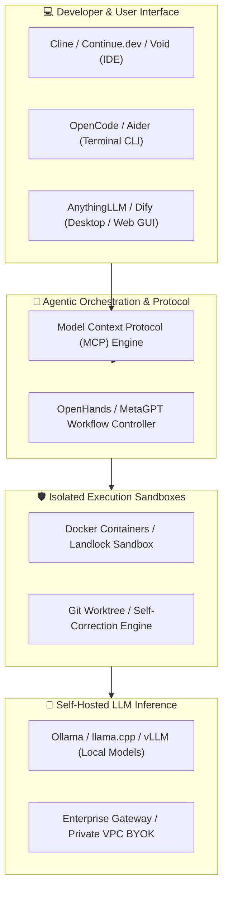

  

  

# 🚀 Awesome Generative AI Copilot 🤖✨

> **A curated, comprehensive directory of enterprise SaaS platforms and open-source generative AI copilots, autonomous agents, and context-aware productivity assistants.**

Welcome to the definitive ecosystem index for **Generative AI Copilots**. As software development, workplace collaboration, and business workflows shift towards **AI-first operations**, copilots bridge large language models (LLMs) with day-to-day tooling. These solutions power autonomous task completion, intelligent code generation, semantic knowledge retrieval, real-time meeting synthesis, and multi-agent coordination with human-in-the-loop oversight.

Whether you are evaluating enterprise SaaS copilots for enterprise productivity or deploying sovereign, self-hosted open-source agents to maintain data privacy and eliminate per-seat SaaS taxes, this repository provides clear pricing comparisons, trial limits, corporate valuations, and live stargazer metrics.

---

## 📑 Table of Contents

- [📊 Sector Overview & Market Dynamics](#-sector-overview--market-dynamics)
- [🏢 Enterprise SaaS & Hosted Copilots](#-enterprise-saas--hosted-copilots)
- [🔓 Open-Source GitHub Projects](#-open-source-github-projects)
- [🏗️ Sovereign Stacks & Architecture](#️-sovereign-stacks--architecture)
- [🤝 How to Contribute](#-how-to-contribute)
- [📈 Star History](#-star-history)
- [💖 Support & Sponsoring](#-support--sponsoring)
- [⚖️ Disclaimer & Compliance](#️-disclaimer--compliance)

---

## 📊 Sector Overview & Market Dynamics

> **Estimated Market Size**: The global **Generative AI Copilot & Autonomous AI Assistant market** is estimated at **$34.8 billion in 2026** and is projected to expand past **$142.5 billion by 2032**, compounding at an annual growth rate (CAGR) of **~36.5%**.

### 🔍 Market Concentration & Fragmentation Analysis
- **Platform & Hyperscaler Layer (High Concentration / Oligopoly)**: At the core foundation model and horizontal suite level, market dynamics are **concentrated among mega-cap tech giants** (Microsoft, Alphabet, and Salesforce). These players command significant distribution leverage by bundling AI assistants directly into ubiquitous enterprise suites (Microsoft 365, Google Workspace, Salesforce CRM).
- **Application & Developer Workflow Layer (Moderately Fragmented)**: In contrast, the IDE, terminal, developer workflow, and vertical domain spaces are **highly dynamic and moderately fragmented**. Fast-moving open-source frameworks (OpenCode, Dify, OpenHands, Cline, Aider) and specialized independent SaaS tools actively counter platform lock-in by offering Model Context Protocol (MCP) flexibility, local LLM inference, and zero-telemetry architectures.

---

## 🏢 Enterprise SaaS & Hosted Copilots

The table below catalogs premier commercial SaaS copilots, **sorted descending by company size** (market capitalization or private valuation).

| 🏢 Platform / Product | 🏛️ Parent Company & Valuation / Revenue | 💰 Starting Tier Pricing | 🎁 Free Tier / Trial Limit | 🎯 Core Focus & Capabilities |
| :--- | :--- | :--- | :--- | :--- |
| **[Microsoft 365 Copilot](https://www.microsoft.com/en-us/microsoft-365)** | **Microsoft** `~$3.12 Trillion` Market Cap `$245B+` Annual Revenue | **$30.00 / user / month** *(Annual commitment; requires Microsoft 365 Business Standard, Premium, or Enterprise base)* | **30-day free trial** for business customers (up to 300 licenses); Copilot Web offers free forever access with standard chat rate limits | Enterprise office suite integration across Word, Excel, PowerPoint, Outlook, and Teams with Microsoft Graph grounding |
| **[GitHub Copilot](https://github.com/features/copilot)** | **Microsoft / GitHub** `~$3.12 Trillion` Parent Market Cap `~$2.0B+` GitHub ARR | **$10.00 / month** *(Individual tier; $100/yr) or **$19.00 / user / month** (Business tier)* | **30-day free trial** with full feature access for Individuals; **Free forever** for verified students, educators, and maintainers of popular OSS | AI pair programmer delivering in-line autocomplete, chat, agent editing loops, and CLI assistance across VS Code and JetBrains |
| **[Google Workspace Gemini](https://workspace.google.com/)** | **Alphabet (Google)** `~$2.15 Trillion` Market Cap `$350B+` Annual Revenue | **$20.00 / user / month** *(Gemini Business add-on with annual commitment, added to Workspace base from $6/user/mo)* | **14-day free trial** of Workspace Gemini add-on (up to 10 users); standalone personal Gemini web app provides free forever chat with Gemini 1.5 Flash | Deep enterprise productivity across Gmail, Docs, Sheets, Slides, and Google Meet with enterprise data privacy guarantees |
| **[Salesforce Einstein Copilot & Agentforce](https://www.salesforce.com/)** | **Salesforce** `~$285 Billion` Market Cap `$35B+` Annual Revenue | **$2.00 / conversation** *(Agentforce standard usage) or **$125.00 / user / month** (Einstein 1 Edition; Starter suite begins at $25/user/mo)* | **30-day free trial** with preloaded CRM dummy data, prompt templates, and autonomous agent test environments (no credit card required) | Conversational CRM querying, automated sales email synthesis, case summarization, and autonomous Agentforce workflows |
| **[ServiceNow Now Assist](https://www.servicenow.com/)** | **ServiceNow** `~$185 Billion` Market Cap `$10B+` Annual Revenue | **$100.00 / user / month** *(Base Now Assist add-on packages; enterprise Assist Capacity Packs start at $1,260/pack/yr)* | **15-day free Personal Developer Instance (PDI)** with Now Assist generative AI skills enabled via ServiceNow Developer Program | ITSM incident summarization, virtual service desk auto-resolution, code generation, and enterprise workflow orchestration |
| **[Atlassian Intelligence](https://www.atlassian.com/)** | **Atlassian** `~$48 Billion` Market Cap `$4.4B+` Annual Revenue | **$14.50 / user / month** *(Included at no extra charge within Jira Cloud Premium; Confluence Cloud Premium starts at $10.50/user/mo)* | **14-day free trial** of Jira/Confluence Cloud Premium with full Atlassian Intelligence capabilities enabled for up to 10,000 users | Issue drafting, sprint synthesis, natural language JQL search queries, and AI-powered Confluence documentation editing |
| **[HubSpot ChatSpot / Breeze AI](https://www.hubspot.com/)** | **HubSpot** `~$31 Billion` Market Cap `$2.2B+` Annual Revenue | **$15.00 / seat / month** *(Service/Sales Hub Starter) or **$90.00 / seat / month** (Professional tier with advanced Breeze AI features)* | **Free forever plan** includes ChatSpot & Breeze AI assistant with 20 prompt credits/user/month and full core CRM platform access | Inbound marketing content generation, CRM record enrichment, sales email sequences, and prospecting insights |
| **[Zoom AI Companion](https://www.zoom.com/)** | **Zoom Video Communications** `~$21 Billion` Market Cap `$4.6B+` Annual Revenue | **$13.33 / user / month** *(Billed annually as Zoom Workplace Pro at $159.90/yr or $15.99/mo; AI Companion included at no added charge)* | **30-day free trial** of Zoom Workplace Pro featuring complete AI Companion meeting summarization, smart chapters, and live query access | Real-time meeting transcription, automated smart chapter generation, action item extraction, and team chat reply drafting |
| **[Notion AI](https://www.notion.com/)** | **Notion Labs** `~$10 Billion` Private Valuation `$300M+` Annual ARR | **$8.00 / member / month** *(Billed annually or $10.00/mo billed monthly; add-on available for any Free or Plus Notion workspace)* | **Free forever plan** includes **20 complimentary AI responses** per workspace member before requiring the paid add-on | Workspace document drafting, meeting notes distillation, table autofill properties, and semantic Q&A across private wikis |
| **[Freshworks Freddy Copilot](https://www.freshworks.com/)** | **Freshworks** `~$4.2 Billion` Market Cap `$600M+` Annual Revenue | **$29.00 / agent / month** *(Billed annually; add-on available on top of Freshdesk/Freshsales Pro starting at $49/agent/mo)* | **14-day free trial** with 500 Freddy AI credits, ticket response generation, and full Copilot features for up to 10 agents | Customer support ticket summarization, agent response drafts, predictive routing, and IT service desk automation |

---

## 🔓 Open-Source GitHub Projects

Explore the leading self-hosted, sovereign, and privacy-preserving generative AI copilots. Ranked in **descending order by GitHub star count**, each entry features a live badge directly linking to its stargazers page.

### 1. [OpenCode](https://github.com/anomalyco/opencode) 
- **Description**: Terminal-native AI coding agent with BYOK (Bring Your Own Key) architecture supporting 75+ model providers via AI SDK, remote SSH orchestration, and autonomous multi-file refactoring loops.
- **Key Features**: Native terminal UI, multi-provider model switching, remote server support, code edit validation.

### 2. [AutoGPT](https://github.com/Significant-Gravitas/AutoGPT) 
- **Description**: Pioneer autonomous AI agent ecosystem capable of chaining LLM reasoning to accomplish complex multi-step web research, code execution, and autonomous business workflows.
- **Key Features**: Recursive task planning, agent builder UI, web search integration, continuous memory management.

### 3. [Dify](https://github.com/langgenius/dify) 
- **Description**: Production-grade LLM application development platform and agentic copilot orchestrator combining visual prompt workflow engineering, advanced enterprise RAG, and multi-agent coordination.
- **Key Features**: Visual agent workflow builder, RAG pipeline with hybrid search, multi-model routing, prompt versioning.

### 4. [OpenHands](https://github.com/OpenHands/OpenHands) 
- **Description**: Autonomous AI software engineering agent platform capable of writing code, browsing documentation, executing terminal commands, and submitting tested pull requests inside secure Docker sandboxes.
- **Key Features**: Sandboxed container execution, SWE-Bench validated performance, interactive web UI, multi-agent sessions.

### 5. [MetaGPT](https://github.com/FoundationAgents/MetaGPT) 
- **Description**: Multi-agent collaborative framework that encodes Standard Operating Procedures (SOPs) into specialized LLM roles (Product Managers, Architects, Project Managers, Engineers, QA) to build entire software systems.
- **Key Features**: Role-based agent orchestration, automated PRD and architecture diagram generation, collaborative code delivery.

### 6. [Cline](https://github.com/cline/cline) 
- **Description**: Autonomous coding agent extension for VS Code and JetBrains featuring step-by-step human approval, Model Context Protocol (MCP) server integration, and terminal command execution.
- **Key Features**: Deep MCP tool connectivity, granular file diff viewing, custom system prompts, multi-provider model support (Anthropic, OpenAI, Ollama).

### 7. [AnythingLLM](https://github.com/Mintplex-Labs/anything-llm) 
- **Description**: All-in-one desktop AI workspace and corporate copilot featuring full enterprise RAG, multi-user permissions, custom AI agent skills, and local zero-telemetry LLM inference.
- **Key Features**: Vector database embedding support, desktop and multi-tenant Docker deployments, custom agent skills, document parsing.

### 8. [Goose](https://github.com/aaif-goose/goose) 
- **Description**: Open-source, extensible AI agent developed in Rust by Block (under the Linux Foundation's Agentic AI Foundation). Acts as a desktop and CLI copilot across coding, data science, and general automation.
- **Key Features**: Rust performance, 70+ MCP tool integrations, cross-platform desktop UI, headless CLI automation mode.

### 9. [GPT Engineer](https://github.com/AntonOsika/gpt-engineer) 
- **Description**: CLI tool that builds entire software applications from high-level natural language prompts, iteratively asking clarifying questions before generating codebases.
- **Key Features**: Interactive prompt clarification, automatic directory scaffolding, git integration, customizable identity prompts.

### 10. [Aider](https://github.com/Aider-AI/aider) 
- **Description**: Terminal-based AI pair programming tool that integrates directly with local git repositories, creates repository maps via Tree-sitter ASTs, and commits code edits with descriptive commit messages.
- **Key Features**: Automated git commits, self-healing test and lint correction loops, multi-file codebase map, voice coding mode.

### 11. [Khoj](https://github.com/khoj-ai/khoj) 
- **Description**: Open-source, personal AI copilot for your second brain. Indexes local documents, notes (Obsidian, Emacs, Notion), and web data with private, conversational search and offline capabilities.
- **Key Features**: Offline local model inference, Obsidian and Emacs plugins, document chat, automated web browsing and research.

### 12. [AgentGPT](https://github.com/reworkd/AgentGPT) 
- **Description**: Autonomous AI agent platform in the browser that configures, executes, and visually inspects recursive sub-tasks to achieve user-defined business goals.
- **Key Features**: Clean browser-based GUI, goal decomposition tree, exportable execution logs, vector database memory.

### 13. [Continue](https://github.com/continuedev/continue) 
- **Description**: Leading modular open-source coding copilot extension for VS Code and JetBrains. Allows developers to connect any LLM (Ollama, LM Studio, Anthropic) with custom inline editing and autocomplete.
- **Key Features**: Tab autocomplete, in-editor chat, codebase context indexing, custom slash commands, CI-enforceable rule checks.

### 14. [ChatDev](https://github.com/OpenBMB/ChatDev) 
- **Description**: Virtual software development laboratory where specialized multi-agent LLMs collaborate as CEO, CTO, Programmer, and Reviewer to build software end-to-end.
- **Key Features**: Multi-agent chat communication chains, automated code review mechanisms, visual execution replay.

### 15. [Tabby](https://github.com/TabbyML/tabby) 
- **Description**: Self-hosted, on-premises AI coding assistant and enterprise alternative to GitHub Copilot. Engineered for high-throughput GPU inference with no external database dependencies.
- **Key Features**: Consumer-grade GPU support, OpenAPI interface, code completion engine, embedded codebase answer index.

### 16. [Void](https://github.com/voideditor/void) 
- **Description**: Open-source alternative to Cursor. A full-featured code editor fork built with native local model support, BYOK integrations, codebase indexing, and multi-turn inline edit sessions.
- **Key Features**: Native Ollama local model integration, full workspace search and context retrieval, inline prompt diffs.

### 17. [Kilo Code](https://github.com/Kilo-Org/kilocode) 
- **Description**: Multi-surface open-source AI coding assistant for VS Code, JetBrains, CLI, and Slack supporting 500+ models with multi-agent orchestration and collaborative parallel problem solving.
- **Key Features**: Multi-model routing, parallel agent swarms, Slack workspace bot integration, enterprise SSO.

### 18. [Roo Code](https://github.com/RooCodeInc/Roo-Code) 
- **Description**: Autonomous AI coding agent for VS Code with custom role presets (Architect, Coder, Ask), Model Context Protocol (MCP) tool utilization, and interactive diff approvals.
- **Key Features**: Custom persona modes, MCP tool management, real-time token tracking, sandboxed terminal validation.

### 19. [Devika](https://github.com/stitionai/devika) 
- **Description**: Agentic software engineer inspired by Devin. Capable of understanding complex programming tasks, conducting web research, planning milestones, and writing tested code.
- **Key Features**: Autonomous planning engine, Playwright web browsing, Git tracking, multi-model backend.

### 20. [FauxPilot](https://github.com/fauxpilot/fauxpilot) 
- **Description**: Open-source on-premises alternative to GitHub Copilot powered by NVIDIA Triton Inference Server and FasterTransformer, running local code models like SalesForce CodeGen.
- **Key Features**: OpenAI-compatible API endpoint, local self-hosted GPU inference, compatible with official Copilot plugins.

### 21. [GenOffice](https://github.com/genspark-ai/genoffice) 
- **Description**: AI-first open-source office suite equipped with document, spreadsheet, and slide copilots, plus a headless CLI that enables agents like Claude Code or Cursor to manipulate office files.
- **Key Features**: Real `.docx`/`.xlsx`/`.pptx` manipulation, built-in AI restyler, agent CLI integration.

### 22. [Sweep](https://github.com/sweepai/sweep) 
- **Description**: AI junior developer assistant that monitors GitHub issues, reads the codebase, writes pull requests with unit tests, and responds to review comments automatically.
- **Key Features**: GitHub webhook integration, automated PR creation, codebase vector search, self-testing CI loops.

### 23. [ONLYOFFICE DocumentServer](https://github.com/ONLYOFFICE/DocumentServer) 
- **Description**: Open-source office productivity suite offering contextual generative AI assistants for document generation, spreadsheet formula crafting, and presentation summarizing.
- **Key Features**: On-premise enterprise deployment, self-hosted LLM connectivity, collaborative multi-user editing.

### 24. [Thunderbolt](https://github.com/thunderbird/thunderbolt) 
- **Description**: Mozilla's open-source, self-hosted enterprise AI client connecting to Model Context Protocol (MCP) servers and Haystack for private workplace copilot workflows.
- **Key Features**: Local single-machine execution, sovereign data compliance, MCP tool integration.

### 25. [Twinny](https://github.com/twinnydotdev/twinny) 
- **Description**: Completely free, privacy-first VS Code extension serving as a direct alternative to GitHub Copilot using Ollama, LM Studio, or local llama.cpp endpoints.
- **Key Features**: Zero telemetry, fill-in-the-middle code completions, chat assistant, local model optimization.

### 26. [Wukong AICRM](https://github.com/WuKongOpenSource/Wukong-AICRM) 
- **Description**: Open-source AI-native CRM and Salesforce alternative powered by conversational LLMs with automated task drafting, email integration, and knowledge RAG.
- **Key Features**: Spring AI / Java 21 stack, enterprise RAG knowledge base, automated customer task generation.

### 27. [Mewbo Assistant](https://github.com/bearlike/Assistant) 
- **Description**: Open agentic workspace stack with agent hypervisors, graph-powered repo wikis, semantic search, and sandboxed Landlock execution for sovereign enterprise teams.
- **Key Features**: Graph-based repository memory, Landlock sandbox security, OIDC/SAML enterprise identity.

---

## 🏗️ Sovereign Stacks & Architecture

For organizations seeking a **100% self-hosted, private Generative AI Copilot stack**, you can combine these best-in-class components:

---

## 🤝 How to Contribute

Contributions are warmly welcomed! Help keep this directory current, accurate, and comprehensive:

1. 🍴 **Fork the repository** on GitHub.
2. 🌿 **Create a new branch** (`git checkout -b feature/add-new-copilot`).
3. ✍️ **Add your entry** adhering to the established structure:
   - For SaaS tools: include verified starting price, explicit free tier / trial terms, parent company valuation, and link.
   - For open-source tools: include official repo link, stargazers badge (`style=social&color=white`), and detailed capabilities.
4. 🧪 **Verify all links and data**.
5. 🚀 **Submit a Pull Request** with a descriptive summary of your additions.

---

## 📈 Star History

---

## 💖 Support & Sponsoring

Thank you for exploring this curated guide to **Generative AI Copilots**! If this repository has helped you discover the ideal AI assistant for your team or personal engineering workflow, please consider showing your support:

- ⭐ **Star this repository** to help other developers and teams discover it.
- 🍴 **Fork and contribute** to help curate the fastest-evolving sector in technology.
- 📢 **Share with your network** on X/Twitter, LinkedIn, Reddit, or developer forums.
- ☕ **Sponsor the maintainer** or buy a coffee via the [GitHub Sponsor Dashboard](https://github.com/sponsors/ishandutta2007).

---

## ⚖️ Disclaimer & Compliance

- This repository is a community-maintained index provided for educational and architectural evaluation purposes.
- Mentions of third-party trademarks and platforms (Microsoft 365, GitHub Copilot, Google Workspace Gemini, Salesforce Einstein, ServiceNow Now Assist, Zoom, etc.) do not imply endorsement or affiliation.
- Organizations deploying generative AI copilots must ensure compliance with global data privacy frameworks (including GDPR, CCPA, and HIPAA), internal intellectual property governance, and robust prompt injection defenses.
